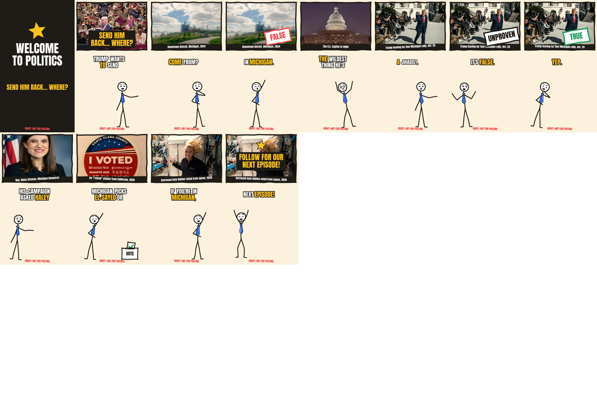
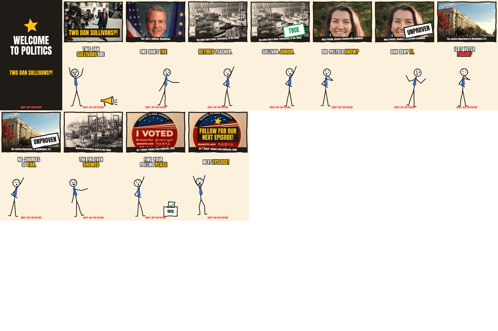

# Video playbook

How a video on this channel should look, sound and open. This is the owner-approved standard, set on 2026-10-31 by reviewing real renders. New videos should match the reference frames below.

**How to use it:** to make a video, run `/make-video` in Claude Code (`.claude/skills/make-video/SKILL.md`), which follows this file. To change the standard, get the owner's OK, then update this file and whatever enforces the rule.

**How much to trust it:** these are the owner's taste and research guidance, not measured results. No video has been posted yet. Once analytics exist (`npm run analytics`), retention data outranks anything here, and the owner decides what changes.

## The opening

- **Open on the most recognizable person in the story.** A clear photo of them fills the panel as soon as the intro ends. Trump grabbed the owner immediately; a crowd and a view of Earth from space didn't. This is about recognition, not about Trump: use whoever is most recognizable and involved, from any party.
- **The intro is a hit, not a segment.** "WELCOME TO POLITICS", a star slamming in and a loud stinger, in 0.8 s. The hook text is on screen from the first frame and the voice starts right after. Never make it longer. Brief R3 advises against intros altogether; the owner chose this anyway, so compare with `intro.seconds: 0` once there's data.
- **The hook creates a question and holds back the answer.** "Trump wants to send this guy back. Wait till you hear where." beat "Trump told a crowd: send this guy back where he came from."
- **Hook text sits on a solid bar**, so it reads over any photo.

## Pace

- Voice speed 1.25 and up to 4 words per caption group. Speed 1.05 with 7-word groups was "way too slow".
- A faster voice shortens the video. If it runs under 61 s, **add lines; don't slow the voice.**
- About 190–235 spoken words total, with the rehook after about 72–88 words.
- No setup line that a sharper line could replace.

## Photos

The test: **can you name the subject in one second?**

| Works | Doesn't |
|---|---|
| Trump walking past the press, thumbs up | Rally crowd where nobody stands out |
| A portrait of the person being named | Earth or a city from space |
| The U.S. Capitol, a skyline, a boat harbor | Aerial views, scenery, anything abstract |
| An "I Voted" sticker; an astronaut by a handwritten "ISS Voting Booth" sign | A distant building that only makes sense with the caption |

- **Mix them.** Not a wall of headshots. Keep at least one oddball, memorable photo.
- **Every photo gets a caption saying what it shows and when.** A 2017 rally must never pass for this week's rally.
- **Check crops.** Tall portraits crop from the top by default. If that cuts a face, set `crop: center` on the panel.
- **Keep verdict stamps off faces.** A stamp across someone's eyes reads as an attack on them, not a verdict on the claim.

### Where photos come from

Only photos you have the right to use: public-domain or CC0 (Wikimedia Commons, White House, Congress, NASA, the military, the Library of Congress), the free stock providers, or images you licensed, dropped into `inbox/stock/` with their real license.

**Never scrape or download photos from news sites.** Agencies like AP and Getty own them, and crediting them doesn't grant the right to use them. News sites are for reading facts. If no free photo exists, use a clear stand-in with an honest caption and tell the owner. There's currently no free photo of Abdul El-Sayed.

## The ending

1. A callback to the hook: "Send him back? Bro's already home."
2. "Follow for our next episode!" with the end card and star. The linter requires this as the last beat.

## Writing that lands

- Build one real joke from a true detail: "One unconfused boat guy" works because the FBI really did go to a boat dealership.
- Say what cuts against our own lean. A left-leaning channel saying plainly that Democrats allegedly recruited a spoiler is what makes the take on the DOJ credible.
- Include what complicates each side, even if it weakens the joke: the retraction, "no charges so far", the other party doing the same thing.
- Open a small question every 10–15 s, and pay it off.

## Posting

Finished videos queue automatically: `npm run ship` clears the script, renders the final without the draft stamp, runs preflight, hosts the file on a GitHub release and queues it in Buffer. Task Scheduler can run all of this twice a day (`automation/setup-tasks.ps1`). Two posts a day at the non-round times in `channel.yaml`, shifting by up to 10 minutes each week (Buffer's API can't edit its queue slots, so each post gets its own exact time, at least 2 hours out). Every video is scheduled, and the owner reviews each one in Buffer on their own time, removing any they don't want. Sources go in the caption, so there's nothing to pin. Owner decision 2026-10-31: this replaces the brief's requirement (§2.8.5) that a human edits each script before posting; watch for videos flagged as unoriginal. TikTok's guidelines say its Direct Post API isn't meant for "a utility tool to help upload contents to the account(s) you or your team manages", so `npm run tiktok` is limited to private test posts or sending videos to TikTok drafts.

Buffer takes video by public URL only, and allows up to 5 hashtags. Use its automatic publishing for now. Original audio is what we have anyway, since trending sounds aren't available through its API.

## What never bends for retention

From `RESEARCH_BRIEF.md` §0.5: sourced facts, verbatim quotes, opinions marked as opinions, allegations said out loud as allegations, voting info only from official sources, no doctored photos, no paid political content, and the owner reviewing every video in Buffer before its slot.

## Reference frames

Key frames from the two approved drafts. These are what "good" looks like.

**El-Sayed fact-check**

**Two Dan Sullivans fact-check**

Their scripts are in `scripts/videos/2026-10-31-*.yaml`, and the Alaska writer brief is in `scripts/prompts/`. When the owner edits a script and sets `human_edited: true`, drafting automatically uses it as a voice example.

## What enforces this

| Rule | Enforced by | If it fails |
|---|---|---|
| Opens on a photo; every photo captioned; ends on the follow line | Linter (`scripts/lint.ts`) | Render is blocked |
| Fast voice, short captions, intro under 1 s | `tests/house-style.test.ts` | `npm run check` fails |
| Real JPEG/PNG at the true minimum size | `render/stock/filter.ts` | Download is rejected |
| Script voice and photo guidance | `channels/politics/voice.yaml`, `scripts/draft.ts` | Shapes every draft |
| "Can you name the subject in one second?" | Only a person or agent looking at `npm run frames` | Nothing automatic; don't skip it |

If a check fails, fix the script. Don't loosen the check or the test to get a render through.
