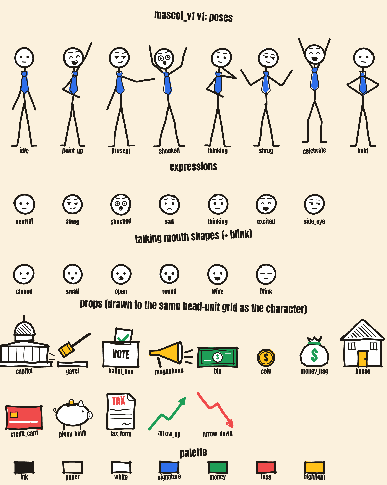

# Style guide — the approved look

Brief §1.2–1.3. The rule: **vary which props, poses and moves appear; never vary how they're drawn.**

*Regenerate with `npm run contact-sheet`. This image is the approved look. New art must match it.*

## Single source of truth: `style.tokens.json`
Nothing is styled per video. Colors, stroke widths, wobble, boil rate, fonts, text sizes, motion timing, layout and lint limits all live in `style.tokens.json`.

### Palette
| Token | Use | Never |
|---|---|---|
| `ink` | All outlines, text outlines | — |
| `paper` | The one constant background on every video | Change per video |
| `white` | Head fill, paper/props fills, caption text | — |
| `signature` (blue) | **The stickman's tie only** | On any prop or text (the lint fails it) |
| `money` (green) | "Good": wins, gains, good numbers | Bad news |
| `loss` (red) | "Bad": losses, warnings, bans | Good news. ⚠️ In US politics red reads as "Republican": never color a party or politician red/blue to editorialize |
| `highlight` (yellow) | Keyword/cover title, small accents | Large fills behind text |

Text contrast is checked by the lint: ink on paper ≥ 7:1, and every caption/keyword fill on its ink outline ≥ 4.5:1.

### Lines
- Three stroke widths only: `fine` (6 px, faces/details/texture), `main` (12 px, bodies and outlines), `bold` (17 px, arrows/emphasis, frames).
- Round caps and joins. No shadows, gradients or drop shadows.
- Every line wobbles slightly; fills are slightly mis-registered from their outlines (marker look).
- **Line boil:** the wobble is re-seeded 10×/s, so the drawing looks alive even when nothing moves.

### Scale grid
- 1 head unit (HU) = the stickman's head = 128 px. The stickman is ≈ 5 HU (≈ 650 px) tall (owner: bigger).
- Every prop declares its `heightHU`. The lint fails a prop that's drawn more than 15% off its declared size, or wider than 3.5 HU.

## Do / don't
| Do | Don't |
|---|---|
| Build props from the pen primitives (`line`, `rect`, `ellipse`, `circle`, `polygon`, `dot`, `hatch`, `scribbleFill`, `label`) | Paste SVG paths, images, emoji, or hex colors into a prop |
| One prop per beat, at its declared size | Scale a prop up "because it's important"; use a camera move (`punch_in`) instead |
| Max 2 accent colors per prop | Rainbow props, or the tie blue on anything else |
| Keep labels short (`TAX`, `$`) in the title font | Paragraphs of text inside a prop |
| Same background (`paper`) every video | Per-video background colors |

## Adding a prop
1. Create `assets/props/<name>.ts` using only `../../render/props/api` (`defineProp`, `u`, `px`, `path`, `arrowHead`). Draw with origin at bottom-center, y negative = up, sizes in HU.
2. Register it in `assets/props/index.ts`.
3. `npm run lint:style`, which checks palette, widths, size grid, accents and imports.
4. `npm run test:update` to write its snapshot, then `npm run contact-sheet` and look at it next to the others.
5. Commit the prop, its snapshot, its thumbnail and the updated contact sheet together.

## Changing the style on purpose
Edit `style.tokens.json` → `npm run check` (snapshots will fail, as intended) → review `npm run contact-sheet` → `npm run test:update` → commit tokens, snapshots and gallery together, with the reason in the commit message.

## Layout (owner, 2026-10-31)
| Zone | Where | What |
|---|---|---|
| Top panel | y 0–760, 36 px padding, bold doodle frame | Stock photo (house treatment) or a drawn meme cutaway |
| Caption band | centered at y ≈ 905, x ≈ 500 (left of the TikTok button column) | Phrase groups of 3–7 words, ≤ 2 lines, Anton, white with ink outline; active word yellow and 1.1×; good/bad words green/red |
| Stage | ground at y 1840; marks at x 250 / 470 / 700 | The stickman moves between marks (walk / slide / hop), tilts, rare spin; the beat's prop on the open side |

## Stock photos (brief §1.7)
Every photo gets the same treatment: cover-crop to the panel, a light warm grade (`stock.warmth`, `stock.saturation`), a slow push-in to `stock.pushScaleEnd` while held, the boiling doodle frame on top, and a whip / punch / flash transition on change (never the same twice in a row). No other filters, stickers or borders.

## Memes (brief §1.8)
Drawn meme *formats* in `assets/memes/`, imported only from `render/memes/api` (lint-enforced), starring the stickman: `expectation_reality`, `nobody_me` (panel cutaways), `zoom_stare` (camera push-in on a deadpan face). Never copyrighted meme images, stills, songs or clips.

## Safe zones
`layout.safeZonePx` in the tokens holds starting values (top 150, right 140, bottom 420, left 60 px). ⚠️ Not yet verified against the current TikTok UI (brief §1.6 TODO). Keep hook text and captions out of these areas.
